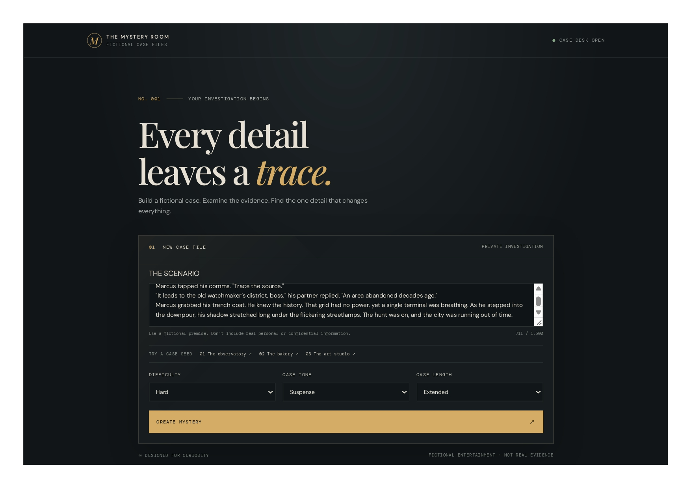
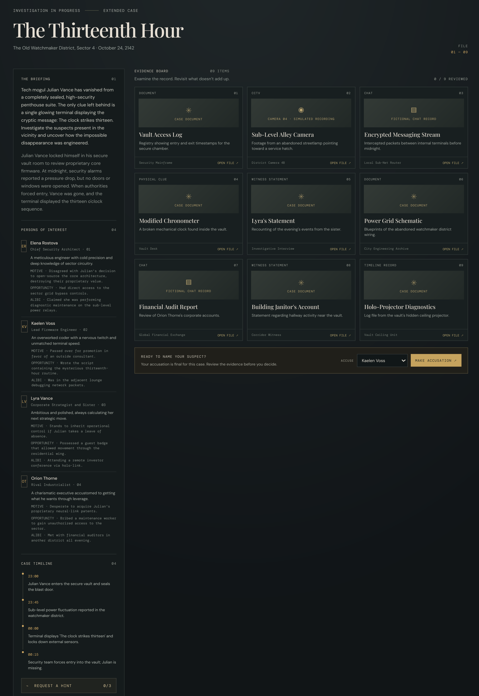
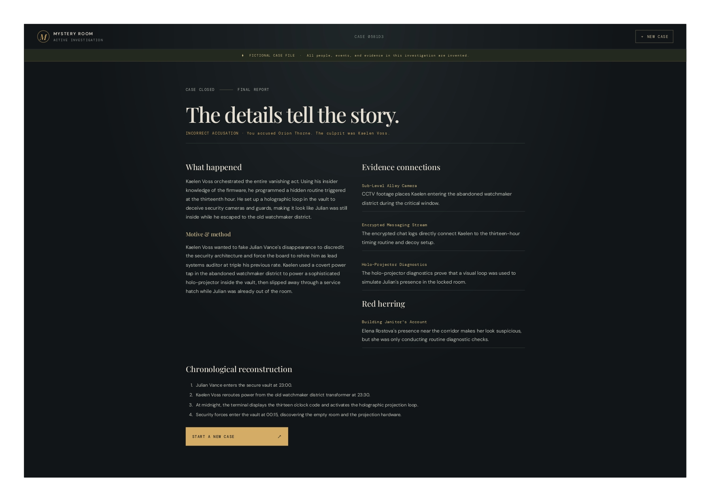

# 🔎 AI Mystery Room

**Every detail leaves a trace.**

AI Mystery Room is a full-stack Generative AI application that transforms fictional scenarios into interactive detective investigations.

Users can create mystery cases, examine evidence, investigate suspects, analyze timelines and submit their final accusations. Each investigation is generated using the Google Gemini API.

<p align="center">
  <a href="https://aimystery-nine.vercel.app/"><strong>🌐 Live Demo</strong></a>
  &nbsp; · &nbsp;
  <a href="https://github.com/vishnushreer96-lgtm/AI_MYSTERY"><strong>💻 Source Code</strong></a>
</p>

> **Note:** All characters, events and evidence are fictional. Certain visual and CCTV evidence elements are simulated placeholders, not actual media recordings.
## 📸 Project Screenshots

### 1. Landing Page


### 2. Investigation Dashboard


### 3. Final Investigation Report

---

## ✨ Features

### 1. AI-Powered Mystery Generation
- Generate fictional detective cases from user-provided scenarios.
- Customize difficulty, case tone and case length.
- Generate suspects, motives, alibis, timelines, evidence and hidden solutions.

### 2. Interactive Investigation Dashboard
- Examine different evidence categories.
- Investigate fictional suspects and their alibis.
- Explore chronological case timelines.
- Request progressive hints to help solve the mystery.

### 3. Evidence-Based Accusation
- Select a suspect and submit a final accusation.
- Evaluate the accusation on the backend.
- Reveal the culprit, motive and explanation.
- Display evidence connections, red herrings and chronological reconstruction.

### 4. Backend Validation and Reliability
- Structured JSON generation using Gemini.
- Schema validation and consistency checks.
- API timeout handling and retry mechanisms.
- Server-side handling of canonical answers and accusation evaluation.

---

## 🛠️ Tech Stack

| Category | Technologies |
|---|---|
| Frontend | React, TypeScript, Vite |
| Backend | Node.js, Express.js |
| AI Integration | Google Gemini API |
| Database | MongoDB, Mongoose |
| Validation | Zod |
| Development | npm Workspaces, ESLint, Vitest |
| Deployment | Vercel, Render |

---

## 🏗️ Project Architecture

The application follows a monorepo structure with separate frontend, backend and shared packages.

```text
AI_MYSTERY/
│
├── apps/
│   ├── api/
│   │   └── src/
│   │       ├── config/
│   │       ├── models/
│   │       ├── services/
│   │       └── utils/
│   │
│   └── web/
│       └── src/
│
├── packages/
│   └── shared/
│
├── docs/
├── README.md
├── package.json
└── spec.md
```

### Application Workflow

1. The user submits a fictional scenario with selected case options.
2. The frontend sends the request to the Express API.
3. The backend validates the input and requests structured case generation from Gemini.
4. Generated content is validated against shared schemas and consistency rules.
5. Validated cases are stored in MongoDB.
6. Users investigate the case and submit an accusation.
7. The backend evaluates the accusation and returns the final investigation report.

---

## ⚙️ Getting Started

### Prerequisites

- Node.js 22 LTS or newer
- npm
- MongoDB local instance or MongoDB Atlas
- Google AI Studio API key
- A Gemini model supported by the Google GenAI API

### 1. Clone the repository

```bash
git clone https://github.com/vishnushreer96-lgtm/AI_MYSTERY.git
```

```bash
cd AI_MYSTERY
```

### 2. Install dependencies

```bash
npm install
```

### 3. Configure environment variables

Create a `.env` file in the repository root.

Add the following configuration:

```env
NODE_ENV=development
PORT=5000

CLIENT_ORIGIN=http://localhost:5173

MONGODB_URI=mongodb://127.0.0.1:27017/ai_mystery_room

GEMINI_API_KEY=your_google_ai_studio_api_key
GEMINI_MODEL=your_supported_gemini_model

AI_REQUEST_TIMEOUT_MS=60000
AI_MAX_RETRIES=2
CASE_RETENTION_DAYS=30
```

Replace the API key and model name with your own configuration.

**Important:** Never commit your `.env` file or expose API credentials in frontend code.

### 4. Start the application

Make sure MongoDB is running, then execute:

```bash
npm run dev
```

The development servers run on:

- Frontend: `http://localhost:5173`
- Backend API: `http://localhost:5000`

---

## 🧪 Available Commands

| Command | Description |
|---|---|
| `npm run dev` | Start frontend and backend |
| `npm run build` | Build all workspaces |
| `npm run lint` | Run ESLint |
| `npm run typecheck` | Run TypeScript checks |
| `npm test` | Run workspace tests |
| `npm run test:api` | Run API tests |

---

## 🚀 Deployment

The application is deployed using:

- **Frontend:** Vercel
- **Backend:** Render
- **Database:** MongoDB Atlas

Live application: https://aimystery-nine.vercel.app/

Production environment variables and API credentials are configured on the backend hosting platform.

---

## 🔐 Data, Security and Limitations

- All generated mysteries are fictional entertainment.
- Gemini API credentials remain on the backend.
- Canonical solutions and accusation evaluation are handled server-side.
- Generated cases are stored in MongoDB with a configurable retention period (30 days by default).
- Image and CCTV evidence currently use simulated placeholders.
- The current MVP does not include user authentication or actual image/video generation.
- Avoid entering real personal, confidential or sensitive information.

---

## 🎯 Project Objective

AI Mystery Room explores the practical integration of Generative AI into a full-stack application, with a focus on structured AI responses, backend validation, database management, API integration and reliable deployment.

**Built to explore the intersection of Generative AI and full-stack software development.**
